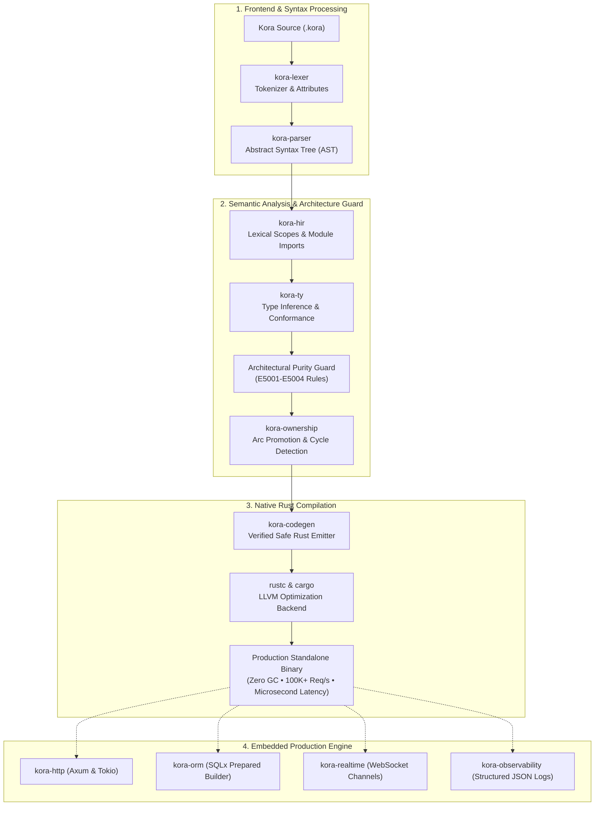

# Kora

<p align="center">
  
</p>

<p align="center">
  <strong>Write Less. Build Faster. Run Smarter.</strong><br>
  <em>A modern compiled backend language and framework powered by Rust.</em>
</p>

<p align="center">
  <a href="#vision"></a>
  <a href="#license"></a>
  <a href="https://github.com/Hwai-technology/kora-framework/releases"></a>
  <a href="https://github.com/Hwai-technology/kora-framework/stargazers"></a>
</p>

> [!IMPORTANT]
> **Public Beta Release (`v0.2.0` / [Latest Release](https://github.com/Hwai-technology/kora-framework/releases))**
> Kora is currently in active public beta and rapid development. While the compiler pipeline, type checker, and native runtime engine are fully functional, language features and standard libraries are evolving continuously.
>
> ⭐️ **Support Kora with a GitHub Star**: If you believe in unifying the approachable developer experience of TypeScript with the raw speed of Rust and the concurrency of Go, please give this repository a star! Every star helps spread the word, attracts contributors, and accelerates Kora's evolution.
>
> 🌍 **Calling Developers Worldwide**: We warmly invite software engineers, compiler enthusiasts, and backend architects from all over the world to join the Kora community! Whether testing examples, proposing RFCs, reporting bugs, or submitting pull requests—your contributions are deeply valued.

---

## 🌟 The Kora Vision

Kora is engineered around one central philosophy:

> **The approachable developer experience and clean syntax of TypeScript, the raw performance and memory safety of Rust, and the simple concurrency model of Go — unified in a single backend language and framework.**

Backend developers shouldn't have to choose between developer speed and system performance. Kora compiles directly to native Rust binaries with zero garbage collection pauses and zero manual borrow-checker friction.

### ⚡ A Taste of Kora (10-Line REST API)
```kora
model Greeting {
    message: String,
    timestamp: Int
}

let app = run()

get("/api/v1/hello", () => {
    return Greeting {
        message: "Hello from Kora!",
        timestamp: 1773000000
    }
})
```

```bash
# 1. Compile and launch native binary on dedicated port 7582
kora run server.kora

# 2. Query the endpoint
curl -i http://localhost:7582/api/v1/hello
# HTTP/1.1 200 OK
# Content-Type: application/json
# {"message":"Hello from Kora!","timestamp":1773000000}
```

---

## ⚡ Quick Start & Cross-Platform Installation

Kora is engineered to be portable and accessible across all major operating systems and architectures.

| Platform / Environment | Method | Command |
|---|---|---|
| **Linux & macOS** (Bash/Zsh) | Automated One-Line Installer | `curl -fsSL https://raw.githubusercontent.com/Hwai-technology/kora-framework/main/install.sh \| bash` |
| **Windows** (PowerShell) | PowerShell One-Line Installer | `irm https://raw.githubusercontent.com/Hwai-technology/kora-framework/main/install.ps1 \| iex` |
| **Linux Standalone** | Portable Self-Contained AppImage | Download `kora-latest-linux-x86_64.AppImage`, `chmod +x`, and run directly |
| **Docker / Container** | GitHub Container Registry (GHCR) | `docker run --rm -it ghcr.io/hwai-technology/kora:latest doctor` |
| **Rust / Cargo** | Build from Source | `cargo install --path crates/kora-cli` |

Detailed setup instructions, editor tooling configuration, and uninstall guides are available in [Installation & Toolchain Setup](docs/getting-started/installation.md).

---

## 🚀 Key Language Features

### 1. Hybrid Object & Data Model (Struct-Free)
Kora eliminates `struct` confusion in favor of two distinct, purposeful constructs:
- **`model`**: Declarative data entities and API DTOs with schema attributes (`@unique`, `@index`, `@required`, `@email`, `@min`, `@max`, `@default`).
- **`class`**: Stateful business logic, controllers, and services with constructor parameter promotion in `init(...)`.
- **`interface`**: Polymorphic contracts verified strictly at compile time.

```kora
model User {
    @unique
    @required
    id: Int

    @unique
    @index
    @required
    @email
    email: String

    @default("customer")
    role: String

    @min(0)
    balance: Int
}

interface UserRepository {
    fn findByEmail(email: String) -> Option<User>
    fn save(user: User) -> Result<User, String>
}

class UserService implements UserRepository {
    repo: UserRepository

    init(repo: UserRepository) {
        this.repo = repo
    }

    fn findByEmail(email: String) -> Option<User> {
        if email == "" {
            return null
        }
        return this.repo.findByEmail(email)
    }

    fn save(user: User) -> Result<User, String> {
        return this.repo.save(user)
    }
}
```

### 2. First-Class `null` & Strict Exclusion of `undefined`
Kora introduces **`null`** as the universal representation of value absence (`Option<T>`).
- Writing `undefined` generates a compile error (`E2005`), eliminating dual-null ambiguity.
- Works seamlessly with direct comparisons and pattern matching:

```kora
let authHeader = req.header("authorization")

if authHeader == null {
    return Err("Missing required authorization header")
}

return match authHeader {
    Some(token) => Ok(token),
    null => Err("Header was empty"),
}
```

### 3. Automatic Constructor & Visibility Modifiers
Classes support `public`, `private`, `protected`, and `readonly` field modifiers, as well as automatic parameter promotion inside `init(...)`.

### 4. Enforced `kebab-case` API Serialization
All API payloads, route responses, and DTOs automatically serialize with `kebab-case` keys (`user-id`, `status-code`, `total-amount`), guaranteeing API consistency across client integrations.

### 5. Architectural Purity Enforcement (Compiler Diagnostics)
The Kora compiler (`kora check`) guards directory boundaries at build time:
- **`E5001`**: Files in `enums/` cannot contain functions or routes.
- **`E5002`**: Files in `models/` or `interfaces/` cannot contain executable server logic or routes.
- **`E5003`**: Controllers and services cannot define inline enums or models; they must be imported.
- **`E5004`**: `main.kora` cannot define inline models or enums in structured projects.

### 6. Python-Style Direct Execution & Smart Entrypoint Discovery
Execute any single script with zero ceremony:
```bash
# Run standalone files directly
kora script.kora
kora app.kr

# Auto-discover entrypoint or scaffold starter main.kora in current folder
kora run
```

### 7. Instant Live Watch Mode & Hot Reloading
Rapid feedback loop during development:
```bash
kora watch
# or target a specific file:
kora watch src/main.kora
```

### 8. Canonical Code Formatter & Linter
Unified code layout across teams:
```bash
kora fmt                # Format all project files
kora fmt --check        # CI verify mode
```

---

## 🏛️ Compiler Pipeline & Architecture



---

## 📊 Implementation Status (What's Working vs. In Progress)

| Pillar | Feature | Status | Notes |
|:---|:---|:---:|:---|
| **Language Frontend** | Lexer, Parser, AST, Diagnostics | ✅ **Ready** | Full tokenization and error reporting with source spans. |
| **Type System** | Static Typing, Generic Inference, `Option<T>` | ✅ **Ready** | Strict `null` (`undefined` forbidden, `E2005`). |
| **Object Model** | `model` (Entities & DTOs) & `class` (DI) | ✅ **Ready** | Auto-constructors, visibility modifiers, zero `struct` confusion. |
| **Clean Architecture** | Boundary enforcement (`E5001`–`E5004`) | ✅ **Ready** | Enforced purity for `enums/`, `models/`, services, and `main.kora`. |
| **Database Engine** | Schema Auto-Sync, Migrations, Seeders | ✅ **Ready** | CLI commands (`kora db <migrate\|sync\|seed\|truncate\|drop\|refresh>`). |
| **Code Generation** | Verified Native Rust Generation | ✅ **Ready** | Compiles to zero-GC native binary via `.kora-build/`. |
| **Async Concurrency** | Non-blocking I/O & Actor/Channels | ✅ **Ready** | MPSC typed channels, broadcast pub/sub, actors (`ask`/`tell`) & `TaskGroup`. |
| **Tooling & Ecosystem**| VS Code / Antigravity IDE Extension | ✅ **Ready** | CodeLens (`▶ Run`), formatOnSave, Go-To-Definition (`F12`), Outline view. |
| **Language Server (LSP)**| JSON-RPC 2.0 Language Server Daemon | ✅ **Ready** | Powers Neovim, Helix, Emacs, and VS Code with completion and hover. |
| **Code Formatter** | Canonical Source Formatter (`kora-fmt`)| ✅ **Ready** | Automatic 4-space indentation, spacing, and CI `--check` verification. |
| **Live Hot-Reload** | Instant Watch Mode (`kora watch`) | ✅ **Ready** | Instant sub-second re-compilation and execution on file change. |
| **OpenAPI 3.1 & Swagger** | Zero-Config Swagger Documentation | ✅ **Ready** | Auto-discovers schemas from `model` & routes into `openapi.json` & `swagger-ui.html`. |
| **Error Diagnostics** | Compiler-Grade Diagnostics (`E1001`–`E1005`) | ✅ **Ready** | Smart CWD detection, copy-paste hints, missing import/cargo guides. |
| **Package Registry** | Distributed Package Manager (`kora-pkg`) | ✅ **Ready** | SemVer solver, SHA-256 lockfile (`kora.lock`) & CLI commands (`kora pkg`). |
| **Scaffolding Suite** | Production Generator (`kora init`/`create`)| ✅ **Ready** | Clean Architecture, Docker Compose, Dockerfile, `.editorconfig`, `.env`, `/health`. |

---

## 📦 Workspace Architecture

All components live in a modular Cargo workspace under `crates/`:

| Crate | Role |
|:---|:---|
| `kora-lexer` | High-speed tokenizer with keyword and attribute scanning. |
| `kora-ast` | Abstract Syntax Tree node definitions. |
| `kora-parser` | Recursive-descent parser with rich diagnostics. |
| `kora-hir` | High-level Intermediate Representation and symbol resolution. |
| `kora-ty` | Static type system, interface verification, and purity checker. |
| `kora-ownership` | Lifetime & concurrency planner: Arc promotion and cycle detection. |
| `kora-codegen` | Transpilation from Kora AST to safe native Rust code. |
| `kora-runtime` | Async concurrency runtime: MPSC channels, broadcast pub/sub, actors & task groups. |
| `kora-http` | Async HTTP engine powered by Axum and Tokio. |
| `kora-orm` | Compile-time query and schema integration with SQL injection immunity. |
| `kora-auth` | Enterprise security: Argon2id password hashing and HMAC-SHA256 JWT tokens. |
| `kora-realtime`| WebSocket channels and domain event streaming. |
| `kora-queue` | Bounded asynchronous task queue engine. |
| `kora-observability` | Structured JSON logging and atomic performance metrics. |
| `kora-fmt` | Canonical code formatting and indentation engine. |
| `kora-lsp` | Language Server Protocol daemon for editor integrations. |
| `kora-bench` | Concurrency and throughput benchmarking suite. |
| `kora-profiler` | High-precision execution profiling and timeline analysis. |
| `kora-testing` | Native unit and integration testing harness. |
| `kora-pkg` | Distributed package manager, SemVer solver, and SHA-256 lockfile engine. |
| `kora-cli` | Primary command-line interface (`run`, `watch`, `fmt`, `check`, `create`, `g`). |

---

## 🛠️ Quickstart Guide

### Prerequisites
- [Rust](https://rustup.rs/) (stable toolchain)
- Cargo

### Building the Toolchain
```bash
# Clone the repository
git clone https://github.com/Hwai-technology/kora-framework.git
cd kora-framework

# Build Kora CLI
cargo build --bin kora

# Verify installation
./target/debug/kora --version
./target/debug/kora --help
```

### Automated System Setup & Updates
```bash
# Run one-step setup (with interactive options: Update, Clean Reinstall, or Uninstall)
./install.sh

# Update globally installed toolchain in one step
kora update

# Verify globally installed toolchain
kora --version
kora help
```

### Creating a Clean Architecture Project
```bash
# Scaffold an ultra-clean, production-ready project (or initialize in current dir via `kora init`)
kora create my-service
cd my-service

# Generate an entire CRUD domain feature in seconds
kora g feature products

# Auto-generate OpenAPI 3.1 & Swagger UI documentation
kora swagger

# Verify architecture & compile
kora check src/main.kora

# Run directly on dedicated port 7582
kora run

# Or launch instant live hot-reloading
kora watch

# Canonicalize code style
kora fmt
```

### 📚 Official Examples & Paradigms Catalog

Kora provides an organized catalog of numbered, self-contained examples in [`examples/`](examples/):

| # | Example Directory | Topic / Paradigm | Description | Command |
|:---:|:---|:---|:---|:---|
| **01** | [`01_hello_world`](examples/01_hello_world/) | **Language Fundamentals** | Models, enums, match expressions, static typing | `kora run examples/01_hello_world/main.kora` |
| **02** | [`02_clean_architecture_users`](examples/02_clean_architecture_users/) | **Clean Architecture REST** | Model/service segregation, DI, validation | `kora run examples/02_clean_architecture_users/main.kora` |
| **03** | [`03_crud_products_api`](examples/03_crud_products_api/) | **CRUD & Dynamic SEO/Geo** | Full HTTP methods, OpenGraph meta, Geo headers | `kora run examples/03_crud_products_api/main.kora` |
| **04** | [`04_mysql_database_orm`](examples/04_mysql_database_orm/) | **Relational MySQL ORM** | Connection pool, prepared queries, Docker Compose | `kora run examples/04_mysql_database_orm/main.kora` |
| **05** | [`05_jwt_auth_argon2`](examples/05_jwt_auth_argon2/) | **Enterprise Security** | Argon2id password hashing, HMAC-SHA256 JWT tokens | `kora run examples/05_jwt_auth_argon2/main.kora` |
| **06** | [`06_realtime_websockets`](examples/06_realtime_websockets/) | **Realtime & WebSockets** | Pub/sub topic broadcasting, channel presence | `kora run examples/06_realtime_websockets/main.kora` |
| **07** | [`07_async_actors_concurrency`](examples/07_async_actors_concurrency/) | **Actor Model Concurrency** | Isolated actor state, MPSC channels, job queues | `kora run examples/07_async_actors_concurrency/main.kora` |
| **08** | [`08_openapi_swagger`](examples/08_openapi_swagger/) | **OpenAPI 3.1 & Swagger** | Zero-config spec discovery, interactive `/docs` UI | `kora run examples/08_openapi_swagger/main.kora` |
| **09** | [`09_enterprise_clean_architecture`](examples/09_enterprise_clean_architecture/) | **Enterprise Showcase** | 40+ files, domain modules, middleware, database | `cd examples/09_enterprise_clean_architecture && kora run` |
| **10** | [`10_dto_validation_and_types`](examples/10_dto_validation_and_types/) | **DTO Defense & Type Safety** | Robust validation, files/images, JSON, arrays, enums | `kora run examples/10_dto_validation_and_types/main.kora` |
| **11** | [`11_operators_control_flow_and_resilience`](examples/11_operators_control_flow_and_resilience/) | **Operators & Try/Catch** | `??`, `+=`, `for..in`, `break`, `continue`, `try/catch/finally` | `kora run examples/11_operators_control_flow_and_resilience/main.kora` |

Read the full catalog documentation in the [`examples/README.md`](examples/README.md).

### Verifying All Examples
```bash
# Type check all numbered examples
for dir in examples/[0-9]*; do
  if [ -f "$dir/main.kora" ]; then
    kora check "$dir/main.kora"
  fi
done

# Verify all 40 architectural files in the enterprise showcase
for f in $(find examples/09_enterprise_clean_architecture/src -name "*.kora"); do
  kora check "$f"
done
```

---

## 🤖 Continuous Quality & Automation

Kora includes an enterprise GitHub Actions workflow suite:
- **CI Pipeline (`ci.yml`)**: Automated formatting (`rustfmt`), linting (`clippy`), unit tests, and compiler verification on every pull request.
- **PR Conventions (`pr-validation.yml`)**: Conventional Commits validation for titles and branches.
- **Native Auto-Merge (`auto-merge.yml`)**: Automated merge queue for approved pull requests passing all checks.
- **Automated Contributor Recognition (`contributors.yml`)**: Automatically updates the contributors gallery upon pull request merge.
- **AI Code Review Agent (`ai-code-review.yml`)**: Automated senior technical reviewer evaluating diffs for Rust correctness, compiler safety, performance, and security.

---

## 🤝 Open Architecture & RFCs: Shaping Kora Together

Kora is an evolving open-source research exploration into language design, ownership inference, and backend developer experience. We invite developers, language designers, compiler engineers, Rust specialists, and backend architects from all over the world to join forces and shape the future of high-performance backend development:

- **⭐ Star the Project**: If Kora inspires you, please star our [GitHub repository](https://github.com/Hwai-technology/kora-framework). Stars help Kora reach more developers worldwide and motivate our team.
- **🌍 Global Community**: Developers from all backgrounds and countries are welcome. Share your thoughts, use cases, and feedback in [GitHub Discussions](https://github.com/Hwai-technology/kora-framework/discussions).
- **💡 Propose an RFC**: Have ideas for language syntax, ownership rules, or standard library APIs? [Open an RFC Issue](https://github.com/Hwai-technology/kora-framework/issues/new?template=feature_request.yml).
- **🛠️ Submit Contributions**: From documentation improvements and tutorial examples to compiler passes and runtime optimizations, pull requests of all sizes are warmly welcomed!

---

## 👥 Contributors

A huge thank you to everyone helping build Kora into the next-generation backend language and framework!

<!-- CONTRIBUTORS:START -->
<!-- Automatically maintained by GitHub Actions -->
<a href="https://github.com/Eng-Ahmet/Eng-Ahmet"></a>
<p><a href="https://github.com/Eng-Ahmet/Eng-Ahmet"><strong>Eng-Ahmet</strong></a></p>
<!-- CONTRIBUTORS:END -->

---

## 📄 License

Kora is open-source software licensed under the [GNU Affero General Public License v3 (AGPL-3.0)](LICENSE).
