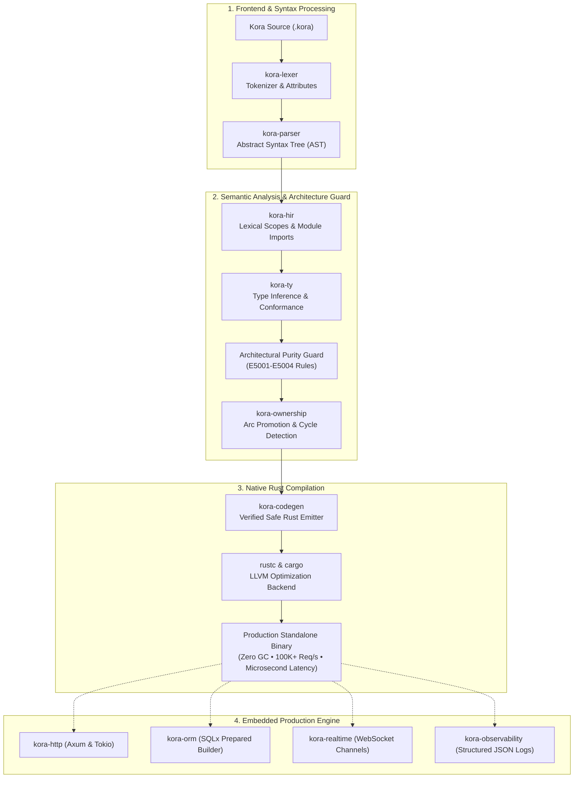

# Kora

<p align="center">
  
</p>

<p align="center">
  <strong>Write Less. Build Faster. Run Smarter.</strong><br>
  <em>A modern compiled backend language and framework powered by Rust.</em>
</p>

<p align="center">
  <a href="#vision"></a>
  <a href="#license"></a>
  <a href="#status"></a>
</p>

---

## 🌟 The Kora Vision

Kora is engineered around one central philosophy:

> **The approachable developer experience and clean syntax of TypeScript, the raw performance and memory safety of Rust, and the simple concurrency model of Go — unified in a single backend language and framework.**

Backend developers shouldn't have to choose between developer speed and system performance. Kora compiles directly to native Rust binaries with zero garbage collection pauses and zero manual borrow-checker friction.

### ⚡ A Taste of Kora (10-Line REST API)
```kora
model Greeting {
    message: String,
    timestamp: Int
}

let app = run()

get("/api/v1/hello", () => {
    return Greeting {
        message: "Hello from Kora!",
        timestamp: 1773000000
    }
})
```

```bash
# 1. Compile and launch native binary
kora run server.kora

# 2. Query the endpoint
curl -i http://localhost:8080/api/v1/hello
# HTTP/1.1 200 OK
# Content-Type: application/json
# {"message":"Hello from Kora!","timestamp":1773000000}
```

---

## 🚀 Key Language Features

### 1. Hybrid Object & Data Model (Struct-Free)
Kora eliminates `struct` confusion in favor of two distinct, purposeful constructs:
- **`model`**: Declarative data entities and API DTOs with schema attributes (`@unique`, `@index`, `@required`, `@email`, `@min`, `@max`, `@default`).
- **`class`**: Stateful business logic, controllers, and services with constructor parameter promotion in `init(...)`.
- **`interface`**: Polymorphic contracts verified strictly at compile time.

```kora
model User {
    @unique
    @required
    id: Int

    @unique
    @index
    @required
    @email
    email: String

    @default("customer")
    role: String

    @min(0)
    balance: Int
}

interface UserRepository {
    fn findByEmail(email: String) -> Option<User>
    fn save(user: User) -> Result<User, String>
}

class UserService implements UserRepository {
    repo: UserRepository

    init(repo: UserRepository) {
        this.repo = repo
    }

    fn findByEmail(email: String) -> Option<User> {
        if email == "" {
            return null
        }
        return this.repo.findByEmail(email)
    }

    fn save(user: User) -> Result<User, String> {
        return this.repo.save(user)
    }
}
```

### 2. First-Class `null` & Strict Exclusion of `undefined`
Kora introduces **`null`** as the universal representation of value absence (`Option<T>`).
- Writing `undefined` generates a compile error (`E2005`), eliminating dual-null ambiguity.
- Works seamlessly with direct comparisons and pattern matching:

```kora
let authHeader = req.header("authorization")

if authHeader == null {
    return Err("Missing required authorization header")
}

return match authHeader {
    Some(token) => Ok(token),
    null => Err("Header was empty"),
}
```

### 3. Automatic Constructor & Visibility Modifiers
Classes support `public`, `private`, `protected`, and `readonly` field modifiers, as well as automatic parameter promotion inside `init(...)`.

### 4. Enforced `kebab-case` API Serialization
All API payloads, route responses, and DTOs automatically serialize with `kebab-case` keys (`user-id`, `status-code`, `total-amount`), guaranteeing API consistency across client integrations.

### 5. Architectural Purity Enforcement (Compiler Diagnostics)
The Kora compiler (`kora check`) guards directory boundaries at build time:
- **`E5001`**: Files in `enums/` cannot contain functions or routes.
- **`E5002`**: Files in `models/` or `interfaces/` cannot contain executable server logic or routes.
- **`E5003`**: Controllers and services cannot define inline enums or models; they must be imported.
- **`E5004`**: `main.kora` cannot define inline models or enums.

---

## 🏛️ Compiler Pipeline & Architecture



---

## 📊 Implementation Status (What's Working vs. In Progress)

| Pillar | Feature | Status | Notes |
|:---|:---|:---:|:---|
| **Language Frontend** | Lexer, Parser, AST, Diagnostics | ✅ **Ready** | Full tokenization and error reporting with source spans. |
| **Type System** | Static Typing, Generic Inference, `Option<T>` | ✅ **Ready** | Strict `null` (`undefined` forbidden, `E2005`). |
| **Object Model** | `model` (Entities & DTOs) & `class` (DI) | ✅ **Ready** | Auto-constructors, visibility modifiers, zero `struct` confusion. |
| **Clean Architecture** | Boundary enforcement (`E5001`–`E5004`) | ✅ **Ready** | Enforced purity for `enums/`, `models/`, services, and `main.kora`. |
| **Database Engine** | Schema Auto-Sync, Migrations, Seeders | ✅ **Ready** | CLI commands (`kora db <migrate\|sync\|seed\|truncate\|drop\|refresh>`). |
| **Code Generation** | Verified Native Rust Generation | ✅ **Ready** | Compiles to zero-GC native binary via `.kora-build/`. |
| **Async Concurrency** | Non-blocking I/O & Actor/Channels | 🟡 **Active** | MPSC typed channels & broadcast pub/sub channels. |
| **Tooling & Ecosystem**| VS Code / Antigravity IDE Extension | 🟡 **Active** | Syntax grammar, snippets, language config & custom icons. |
| **Package Registry** | Distributed Package Manager (`kora-pkg`) | 🔄 **Planned** | Dependency resolution and community module hosting. |

---

## 📦 Workspace Architecture

All components live in a modular Cargo workspace under `crates/`:

| Crate | Role |
|:---|:---|
| `kora-lexer` | High-speed tokenizer with keyword and attribute scanning. |
| `kora-ast` | Abstract Syntax Tree node definitions. |
| `kora-parser` | Recursive-descent parser with diagnostics. |
| `kora-hir` | High-level Intermediate Representation and symbol resolution. |
| `kora-ty` | Static type system, interface verification, and purity checker. |
| `kora-codegen` | Transpilation from Kora AST to safe native Rust code. |
| `kora-http` | Async HTTP engine powered by Axum and Tokio. |
| `kora-orm` | Compile-time query and schema integration. |
| `kora-realtime`| WebSocket channels and domain event streaming. |
| `kora-cli` | Command-line interface (`check`, `build`, `run`, `codegen`). |

---

## 🛠️ Quickstart Guide

### Prerequisites
- [Rust](https://rustup.rs/) (stable toolchain)
- Cargo

### Building the Toolchain
```bash
# Clone the repository
git clone https://github.com/Hwai-technology/kora-framework.git
cd kora-framework

# Build Kora CLI
cargo build --bin kora

# Verify installation
./target/debug/kora --help
```

### Checking and Compiling Files
```bash
# Type check a Kora file
./target/debug/kora check examples/hello.kora

# Generate native Rust code
./target/debug/kora codegen examples/hello.kora
```

### Running the Clean Architecture Showcase
```bash
# Verify all 40 architectural files in the real-world showcase
for f in $(find examples/realworld_clean_architecture/src -name "*.kora"); do
  ./target/debug/kora check "$f"
done
```

---

## 🤖 Continuous Quality & Automation

Kora includes an enterprise GitHub Actions workflow suite:
- **CI Pipeline (`ci.yml`)**: Automated formatting (`rustfmt`), linting (`clippy`), unit tests, and compiler verification on every pull request.
- **PR Conventions (`pr-validation.yml`)**: Conventional Commits validation for titles and branches.
- **Native Auto-Merge (`auto-merge.yml`)**: Automated merge queue for approved pull requests passing all checks.
- **Automated Contributor Recognition (`contributors.yml`)**: Automatically updates the contributors gallery upon pull request merge.
- **AI Code Review Agent (`ai-code-review.yml`)**: Automated senior technical reviewer evaluating diffs for Rust correctness, compiler safety, performance, and security.

---

## 🤝 Open Architecture & RFCs: Shaping Kora Together

Kora is an evolving open-source research exploration into language design, ownership inference, and backend developer experience. We invite language designers, compiler engineers, Rust developers, and systems architects to challenge our assumptions, critique our design, and shape the roadmap:

- **Type System Design**: Help refine our single-`null` semantics and generic trait bounds.
- **Ownership & Lifetime Inference**: Debate how high-level closures and services should be Arc-promoted across Tokio runtime boundaries.
- **Compiler Optimizations**: Propose optimizations for our HIR-to-Rust transpilation pipeline.

Have a critique, question, or design proposal? [Open an RFC Issue](https://github.com/Hwai-technology/kora-framework/issues/new?template=feature_request.yml) or start a discussion!

---

## 👥 Contributors

A huge thank you to everyone helping build Kora into the next-generation backend language and framework!

<!-- CONTRIBUTORS:START -->
<!-- Automatically maintained by GitHub Actions -->
<a href="https://github.com/Eng-Ahmet/Eng-Ahmet"></a>
<p><a href="https://github.com/Eng-Ahmet/Eng-Ahmet"><strong>Eng-Ahmet</strong></a></p>
<!-- CONTRIBUTORS:END -->

---

## 📄 License

Kora is open-source software licensed under the [MIT License](LICENSE).
