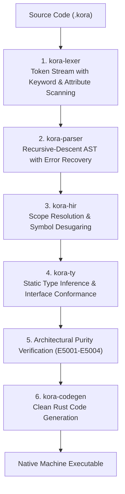

# About Kora: Architectural Manifesto & Technical Deep-Dive

---

## 1. Executive Summary: The Trinity Philosophy

Modern backend development often forces engineering teams into difficult trade-offs:
- **TypeScript**: Exceptional developer ergonomics, rapid iteration, and rich type definitions—yet bottlenecked by single-threaded execution, V8 runtime overhead, and runtime type erasure.
- **Rust**: Unmatched throughput, memory safety without a garbage collector, and rock-solid reliability—yet burdened by steep learning curves, lifetime annotations, and boilerplate framework plumbing.
- **Go**: Lightweight concurrency via goroutines and fast compile times—yet limited by minimal object-oriented constructs, lack of algebraic variants, and runtime GC pauses.

**Kora** resolves this fundamental tension by uniting all three paradigms into a coherent, compiled programming language and full-stack backend framework:

```text
               TypeScript
         (Ergonomics & Clean Syntax)
                    ▲
                   / \
                  /   \
                 /  ★  \
                / KORA  \
               /         \
              ▼           ▼
            Rust          Go
    (Safety & Zero-GC)  (Lightweight Concurrency)
```

1. **Ergonomics of TypeScript**: Familiar class structures, declarative models, optional semicolons, intuitive arrow functions, and clear type inference.
2. **Safety and Speed of Rust**: Compilation directly to native Rust and machine code with zero garbage collector (Zero-GC), zero memory leaks, and deterministic resource release (RAII).
3. **Concurrency of Go**: Lightweight async task scheduling and channels designed for high-concurrency cloud workloads.

---

## 2. Language Design & Type System

### 2.1 The Struct-Free Design Model
Unlike languages that mix structs and classes with overlapping semantics, Kora cleanly separates data from behavior:

- **`model`**: Immutable or mutable pure data entities and DTOs. Decorated with schema metadata:
  ```kora
  model CustomerProfile {
      @unique
      @required
      id: Int

      @unique
      @index
      @required
      @email
      email: String

      @default("member")
      tier: String

      @min(0)
      rewardPoints: Int
  }
  ```
- **`class`**: Stateful domain services, controllers, and infrastructure providers with constructor parameter promotion in `init(...)`:
  ```kora
  class CustomerService {
      repo: CustomerRepository

      init(repo: CustomerRepository) {
          this.repo = repo
      }
  }
  ```
- **`interface`**: Decoupled polymorphic contracts verified at compile time:
  ```kora
  interface CustomerRepository {
      fn findById(id: Int) -> Option<CustomerProfile>
  }
  ```

### 2.2 Strict Single-Null Discipline
To prevent the notorious dual-null problem (`null` vs `undefined`), Kora permits **only `null`**:
- `null` evaluates to `Option<T>::None`.
- The token `undefined` triggers a compile error (`E2005`), ensuring consistent API contracts.

### 2.3 Strict `kebab-case` API Contract
All outbound JSON responses and inbound request envelopes are serialized strictly using `kebab-case` naming conventions (`user-id`, `status-code`, `created-at`).

---

## 3. Compiler Engineering & Pipeline

The Kora compilation pipeline processes source files through six distinct stages:



### Architectural Purity Diagnostics
Kora enforces Clean Architecture rules directly within the compiler:
- `E5001`: Prohibits executable logic or route handlers inside `enums/`.
- `E5002`: Prohibits server runners and route listeners inside `models/` or `interfaces/`.
- `E5003`: Prohibits inline model or enum declarations in services and controllers.
- `E5004`: Prohibits inline model and enum declarations in `main.kora`.

---

## 4. Memory Management: 3-Tier Ownership Inference

Kora achieves memory safety without a Garbage Collector through a compile-time 3-Tier Ownership Inference model:

1. **Local Borrowing (`Tier 1`)**: Variables passed within sequential local execution are automatically inferred as stack references (`&T` / `&mut T`).
2. **Move Semantics (`Tier 2`)**: Data transferred across return boundaries or into data constructors are transferred deterministically.
3. **Thread-Safe Handles (`Tier 3`)**: Service classes injected via Dependency Injection or shared across asynchronous tasks are automatically wrapped in zero-cost thread-safe reference counts (`Arc<T>`).

This architecture guarantees that Kora developers never encounter manual lifetime annotations (`'a`) while still enjoying native zero-pause execution.

---

## 5. Built-in Enterprise Services

Kora provides standard, production-ready enterprise services out of the box:

- **`JwtService`**: Cryptographically signed access and refresh tokens.
- **`CryptoService`**: Argon2id password hashing and AES-256-GCM authenticated encryption.
- **`StorageService`**: Multi-target storage supporting local filesystems and Cloudflare R2 / S3 object storage with pre-signed URLs.
- **`ValidationService`**: Dynamic constraint validation (emails, lengths, ranges, UUIDs, URLs).
- **`SessionService`**: Sliding TTL session tracking and token revocation.
- **`CacheService`**: Multi-tier caching with key invalidation.
- **`Logger`**: Structured JSON logging with severity levels and correlation IDs.

---

## 6. Development Automation & Ecosystem

- **VS Code Extension**: Syntax highlighting, snippet library, and custom Kora file icons in `.vscode/icons/`.
- **CI/CD Automation**: GitHub Actions for formatting, Clippy linting, compiler test suites, and automated PR validation.
- **Native Auto-Merge**: Automated pull request merging for green builds.
- **Automated Contributor Recognition**: Dynamic contributor updates in `README.md`.
- **AI Code Review Agent**: Pre-merge technical analysis across Rust safety, compiler consistency, and architecture.

---

## 7. Technical Horizon & Roadmap

- **Phase 1 (Completed)**: Core grammar, lexer, parser, AST, type checker, codegen, ownership inference, and clean architecture enforcement.
- **Phase 2 (Completed)**: Pure `null` support, removal of `struct`, `kebab-case` serialization, ambient database pool, and enterprise services.
- **Phase 3 (Current)**: Language Server Protocol (LSP) enhancements, package registry (`kora pkg`), and integrated database migrations.
- **Phase 4 (Planned)**: Native LLVM backend compilation target alongside the Rust transpilation pipeline.
