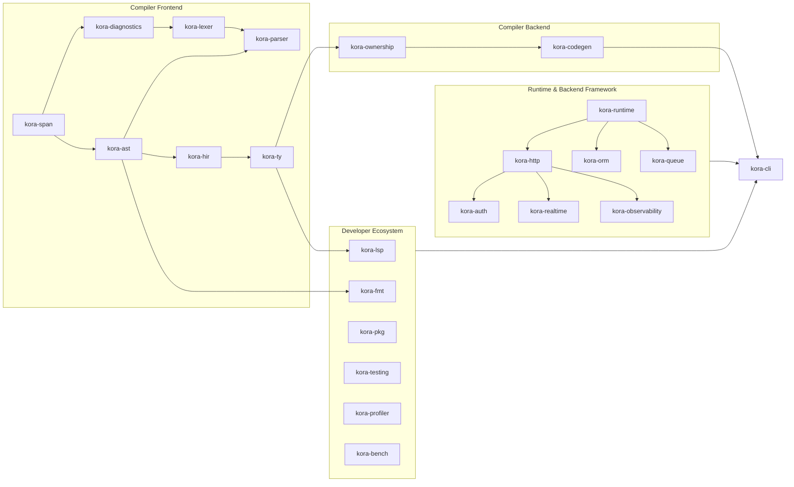

# About Kora Framework — The Complete Architectural & Engineering Encyclopedia

> **Kora — Write Less. Build Faster. Run Smarter.**  
> *A modern compiled backend programming language, ownership-inferring compiler, async runtime, ORM, and full-stack developer ecosystem powered by Rust.*

---

## Comprehensive Table of Contents

1. [Chapter 1: Vision, Core Philosophy & Corrected Engineering Promises](#1-chapter-1-vision-core-philosophy--corrected-engineering-promises)
2. [Chapter 2: Unified Workspace Architecture & Crate Dependency Graph](#2-chapter-2-unified-workspace-architecture--crate-dependency-graph)
3. [Chapter 3: Compiler Frontend Deep Dive (`span` -> `lexer` -> `parser` -> `hir` -> `ty`)](#3-chapter-3-compiler-frontend-deep-dive-span---lexer---parser---hir---ty)
4. [Chapter 4: Complete Kora Language & Type System Specification (Including Phase 5)](#4-chapter-4-complete-kora-language--type-system-specification-including-phase-5)
5. [Chapter 5: 3-Tier Ownership Inference (`kora-ownership`) & Rust Codegen (`kora-codegen`)](#5-chapter-5-3-tier-ownership-inference-kora-ownership--rust-codegen-kora-codegen)
6. [Chapter 6: Async Runtime & Structured Concurrency (`kora-runtime`)](#6-chapter-6-async-runtime--structured-concurrency-kora-runtime)
7. [Chapter 7: Zero-Config HTTP Engine, Validation & OpenAPI 3.1 (`kora-http`)](#7-chapter-7-zero-config-http-engine-validation--openapi-31-kora-http)
8. [Chapter 8: Compile-Time Dependency Injection & Interface Polymorphism](#8-chapter-8-compile-time-dependency-injection--interface-polymorphism)
9. [Chapter 9: Low-Overhead Data Engine, ORM, Transactions & Migrations (`kora-orm`)](#9-chapter-9-low-overhead-data-engine-orm-transactions--migrations-kora-orm)
10. [Chapter 10: Contextual Security, Auth, RBAC & Rate Limiting (`kora-auth`)](#10-chapter-10-contextual-security-auth-rbac--rate-limiting-kora-auth)
11. [Chapter 11: Queues, Realtime WebSockets/SSE & OpenTelemetry Observability](#11-chapter-11-queues-realtime-websocketssse--opentelemetry-observability)
12. [Chapter 12: Developer Ecosystem — CLI, Package Manager, Formatter, LSP & Profiler](#12-chapter-12-developer-ecosystem--cli-package-manager-formatter-lsp--profiler)
13. [Chapter 13: Built-In Testing Framework & Reproducible Benchmark Protocol](#13-chapter-13-built-in-testing-framework--reproducible-benchmark-protocol)
14. [Chapter 14: Multi-Platform Delivery, `.agent/` Governance & Phase 1–8 Matrix](#14-chapter-14-multi-platform-delivery-agent-governance--phase-18-matrix)

---

## 1. Chapter 1: Vision, Core Philosophy & Corrected Engineering Promises

### 1.1 The Fundamental Backend Dilemma

Modern backend engineering forces teams into an expensive architectural trade-off between two worlds:

1. **High-Productivity Dynamic / Managed Frameworks (PHP/Laravel, Node.js/Fastify/NestJS, Python/Django, Ruby/Rails)**:
   - **Strengths**: Clean ergonomics, batteries-included cohesive ecosystems (routing, ORM, auth, queues, caching, realtime, CLI scaffolding), and rapid feature delivery.
   - **Structural Bottlenecks**:
     - Interpreted execution or Garbage Collection (GC) pauses that inflate `P95`/`P99` tail latencies under load.
     - High baseline memory footprint per worker process.
     - Runtime reflection, untyped wiring, `null`/`undefined` hazards, and errors discovered only in production.

2. **Systems & Compiled Languages (Rust + Axum/Actix, C++, Go)**:
   - **Strengths in Rust**: Native machine-code speed, predictable sub-millisecond tail latency, zero Garbage Collector (`Zero-GC`), fearless thread safety, and minimal RAM footprint.
   - **Friction for Application Teams**:
     - Steep cognitive overhead around explicit lifetime parameters (`'a`), complex async trait bounds (`Pin<Box<dyn Future<Output = T> + Send + 'static>>`), and fragmented library ecosystems requiring manual assembly of 15+ third-party crates.
   - **Trade-offs in Go**: Still relies on a Garbage Collector, verbose repetitive error boilerplate (`if err != nil`), and lacks algebraic sum types (`enum` with payloads, exhaustive `match`) and non-nullable `Option<T>` safety.

### 1.2 What Kora Actually Is (6 Integrated Pillars)

Kora is **not** a thin macro wrapper over Rust. Kora is a **vertically integrated compiled backend platform** composed of six tightly engineered pillars:

| Pillar | Subsystem | Architectural Responsibility |
| :--- | :--- | :--- |
| **1. Kora Language** | Surface Syntax & Semantics | Clean, semicolon-optional syntax inspired by TypeScript, Kotlin, and Swift; strong static typing; bidirectional type inference; generics; modules; extension methods; algebraic `enum`s; hybrid object model. |
| **2. Kora Compiler** | `span -> lexer -> parser -> hir -> ty -> ownership -> codegen` | Multi-pass static compiler that verifies syntax, scopes, types, interface contracts, DI constructors, exhaustiveness, and ownership **before** lowering to `#![forbid(unsafe_code)]` Rust compiled via LLVM into a native binary. |
| **3. Kora Runtime** | `kora-runtime` | Structured async task execution, work-stealing I/O scheduling atop `Tokio`, CPU thread-pool offloading (`spawn_blocking`), typed `Channel<T>` message passing, and graceful OS signal shutdown. |
| **4. Kora Framework** | `kora-http`, `kora-auth`, `kora-queue`, `kora-realtime`, `kora-observability` | Cohesive batteries-included backend modules: `Axum`/`Hyper` HTTP engine, compile-time DI, automatic OpenAPI 3.1 docs, Argon2id/JWT/RBAC security, background queues, WebSockets/SSE, and OpenTelemetry metrics/tracing. |
| **5. Kora Data Engine** | `kora-orm` | Parameterized, injection-safe query builder, relation loader, ACID transaction manager, checksummed migration runner, soft deletes, and TTL cache built atop `SQLx` (PostgreSQL primary + embedded SQLite test engine). |
| **6. Kora Ecosystem** | `kora-cli`, `kora-pkg`, `kora-fmt`, `kora-lsp`, `kora-testing`, `kora-profiler`, `kora-bench` | End-to-end developer workflow: project scaffolding, `kora.toml` / `kora.lock` package management, hot-reload dev loop, AST formatter/linter, IDE Language Server Protocol, profiler, and reproducible benchmark harness. |

### 1.3 Corrected Engineering Promises (Rigorous Honesty Over Hype)

Kora intentionally rejects impossible or misleading marketing slogans in favor of verifiable systems engineering:

| Naive Marketing Claim | Kora's Real Engineering Architecture |
| :--- | :--- |
| *"Zero-GC with zero memory rules"* | **Zero-GC via 3-Tier Ownership Inference**: Lifetimes are hidden from surface syntax, not ignored. `kora-ownership` infers local borrows (`&T`, `&mut T`), deterministic moves, and `Arc<T>` promotion across async/DI boundaries, emitting Kora-native `E5xxx` diagnostics when aliasing cannot be proven safe. |
| *"Auto-Async everything magically"* | **Explicit Cooperative Async + CPU Isolation**: I/O boundaries (`async fn`, `await`, HTTP handlers, DB queries) run asynchronously on `Tokio` tasks, while CPU-heavy work (like Argon2 password hashing) is explicitly isolated on blocking worker pools so event loops never starve. |
| *"Zero-Cost Database ORM"* | **Low-Overhead Compile-Time ORM**: Network and PostgreSQL execution always have physical cost. Kora eliminates *framework* overhead—zero runtime reflection, zero dynamic AST string concatenation, connection pooling, and 100% prepared parameterized bindings. |
| *"Automatic invulnerability to XSS/CSRF"* | **Context-Aware Secure-by-Default Controls**: Security depends on transport context. Kora enforces parameterized SQL in `kora-orm`, strict JSON `Content-Type` + `nosniff` headers in `kora-http`, explicit CSRF token verification on state-changing cookie routes, CORS allowlists, and sliding-window rate limits. |

---

## 2. Chapter 2: Unified Workspace Architecture & Crate Dependency Graph

### 2.1 Single Source of Truth in `crates/`

To prevent duplicate module trees and ambiguous Cargo package boundaries, **every** compiler stage, runtime library, backend module, and developer tool lives inside a single Cargo Workspace under `crates/`:

```text
kora/
├── Cargo.toml                  # Workspace manifest (`edition = "2024"`, `unsafe_code = "forbid"`)
├── kora.toml                   # Project & package manifest
├── kora.lock                   # Deterministic dependency lockfile
├── README.md                   # Quickstart overview
├── about-framework.md          # Complete architectural & implementation encyclopedia
├── CONTRIBUTING.md             # Atomic language-evolution contribution rules
├── SECURITY.md                 # Security invariants & vulnerability policy
├── CHANGELOG.md                # Release history
├── LICENSE                     # MIT License
│
├── crates/
│   ├── kora-span/              # SourceMap, FileId, BytePos, Span, O(log L) UTF-8 line/col lookup
│   ├── kora-diagnostics/       # Structured E1xxx-E5xxx diagnostics, snippet carets & hints
│   ├── kora-ast/               # Complete Abstract Syntax Tree (declarations, generics, async, routes)
│   ├── kora-lexer/             # Lexical analyzer with `had_newline_before` optional-semicolon tracking
│   ├── kora-parser/            # Recursive-descent + Pratt parser with ambiguity lookahead & recovery
│   ├── kora-hir/               # High-Level IR, module imports, prelude & lexical symbol resolution
│   ├── kora-ty/                # Bidirectional static type checker, generics, extensions, DI & exhaustiveness
│   ├── kora-ownership/         # 3-Tier ownership, borrow (`&T`/`&mut T`) & async `Arc<T>` escape analyzer
│   ├── kora-codegen/           # Safe Rust source & Cargo project emitter + native binary builder
│   ├── kora-runtime/           # Tokio multi-threaded runtime, typed channels, graceful shutdown
│   ├── kora-http/              # Axum/Tower/Hyper HTTP engine, routing, validation & OpenAPI 3.1 generator
│   ├── kora-orm/               # SQLx (Postgres + SQLite) query builder, relations, transactions, migrations
│   ├── kora-auth/              # Argon2id hashing, HMAC-SHA256 JWT, sessions, RBAC, CORS, CSRF, rate limit
│   ├── kora-queue/             # Async job queues, worker pools, exponential retries, DLQ & scheduler
│   ├── kora-realtime/          # WebSockets hub, Server-Sent Events (SSE) & typed Pub/Sub broadcaster
│   ├── kora-observability/     # Structured JSON logging, metrics histograms, OpenTelemetry spans, health checks
│   ├── kora-pkg/               # `kora.toml` / `kora.lock` package & plugin manager
│   ├── kora-fmt/               # Deterministic AST code formatter & static style/safety linter
│   ├── kora-lsp/               # JSON-RPC 2.0 Language Server Protocol (diagnostics, hover, completion, goto-def)
│   ├── kora-testing/           # Unit, integration, DI mock & HTTP test runner
│   ├── kora-profiler/          # Execution timing, throughput & memory allocation profiler
│   ├── kora-bench/             # Load generator & multi-framework benchmark suite (`Req/s`, `P50/P95/P99`)
│   └── kora-cli/               # Official `kora` developer CLI orchestrating all subsystems
│
├── docs/                       # Formal specifications (`architecture.md`, `grammar.ebnf`, `language-tour.md`)
├── examples/                   # Verified end-to-end `.kora` programs
├── benchmarks/                 # Reproducible comparison harnesses (Kora, Rust+Axum, Node, Go, Laravel)
├── integrations/               # `vscode/` extension, `docker/` multi-stage images, `github-actions/` CI
└── .agent/                     # AI-agent rules, coding/security/perf standards & 7 specialist personas
```

### 2.2 Unidirectional Dependency DAG

No crate in the compiler frontend may import a downstream stage, and every crate inherits workspace-wide `#![forbid(unsafe_code)]`:



---

## 3. Chapter 3: Compiler Frontend Deep Dive (`span` -> `lexer` -> `parser` -> `hir` -> `ty`)

### 3.1 Zero-Copy Byte Spans & UTF-8 Line/Column Resolution (`kora-span`)

Copying string slices into every token and AST node wastes heap allocations. Instead:
- `SourceMap` stores each loaded `.kora` file once inside a `SourceFile` identified by a 4-byte `FileId(u32)`.
- Upon loading a file, `SourceFile::new` scans newline bytes (`\n`) in a single linear pass to build `line_starts: Vec<u32>`.
- Every AST node, token, HIR symbol, and diagnostic label carries a 12-byte `Span { file_id, start, end }`.
- When rendering diagnostics or serving LSP hover/go-to-definition requests, `SourceFile::line_col(byte_pos)` runs an $O(\log L)$ binary search over `line_starts` and counts UTF-8 scalar values (`chars().count()`) from the start of the line—guaranteeing accurate column positions even when comments or string literals contain Arabic, CJK, or emoji characters.

### 3.2 Structured Compiler Diagnostics (`kora-diagnostics`)

A non-negotiable invariant of Kora is **Zero Raw `rustc` Error Leakage**: errors in `.kora` code are caught and formatted by `kora-diagnostics` referencing `.kora` filenames, lines, and columns.

| Code Range | Subsystem | Representative Errors |
| :--- | :--- | :--- |
| **`E1000`–`E1999`** | `kora-lexer` | `E1001` unexpected character, `E1002` unterminated `/* ... */` comment, `E1003` numeric literal overflow, `E1004` invalid string escape, `E1005` unterminated string literal. |
| **`E2000`–`E2999`** | `kora-parser` | `E2001` unexpected token in declaration/statement, `E2002` invalid primary expression, `E2003` malformed `match` pattern, `E2004` duplicate `init` constructor in `class`. |
| **`E3000`–`E3999`** | `kora-hir` | `E3001` duplicate top-level symbol, `E3002` duplicate field, `E3003` duplicate method, `E3004` duplicate enum variant, `E3005` `this` outside `class`, `E3006` undefined identifier, `E3007` unknown type/interface, `E3008` mutation of immutable `let` binding. |
| **`E4000`–`E4999`** | `kora-ty` | `E4001` static type mismatch, `E4002` unconstrained inference (`None` / untyped closure param), `E4003` generic arity mismatch, `E4004` missing struct/model field, `E4005` unknown member/method, `E4006` duplicate field initializer, `E4007` non-callable expression or wrong argument count, `E4008` missing interface method, `E4009` incompatible interface method signature, `E4010` non-exhaustive `match`, `E4011` missing return on control-flow path, `E4012` non-injectable DI constructor parameter, `E4013` `await` outside `async` context or on non-async value. |
| **`E5000`–`E5999`** | `kora-ownership` | `E5001` use of moved value after explicit consumption, `E5002` conflicting mutable escape across concurrent async task boundary, `E5003` cyclic DI constructor dependency graph. |

### 3.3 ASI-Free Optional Semicolons (`kora-lexer`)

Languages with naive Automatic Semicolon Insertion (like JavaScript) suffer from silent misparses when a line starts with `(` or `[`. Kora solves this cleanly without polluting the token stream with newline tokens:
- Every `Token` carries `pub had_newline_before: bool`.
- Multi-line expressions, struct literals, and chained `.` member accesses ignore line breaks naturally.
- Statement-sensitive constructs check `peek().had_newline_before`:
  - `return` followed by a newline immediately terminates as `Return { value: None }` (`Unit`).
  - Postfix call `expr(...)` and index `expr[...]` only attach if `!peek().had_newline_before`, so starting a new line with a closure `(req: Request) => ...` never accidentally invokes the previous line's expression!

### 3.4 Hybrid Recursive-Descent + Pratt Parser (`kora-parser`)

`kora-parser` combines:
1. **Top-Down Recursive Descent** for module declarations (`module`, `import`, `pub`, `struct`, `model`, `interface`, `class`, `enum`, `extend`, `async fn`, `fn`) and control-flow statements.
2. **Pratt Precedence Climbing** (`parse_binary_expr`) across 6 binding-power tiers (`||` < `&&` < `== !=` < `< <= > >=` < `+ -` < `* / %`) plus unary prefix (`!`, `-`, `await`) and postfix (`.`, `()`, `[]`).
3. **Zero-Backtracking Disambiguation**:
   - **Struct Literal vs Block**: `with_struct_lit(false, ...)` disables struct literals in `if`, `while`, and `match` headers (unless parenthesized), reinforced by `looks_like_struct_lit_body()` which verifies `{}` or `{ ident: ... }`.
   - **Closure vs Grouped Expression**: `is_closure_start()` scans ahead across `(...)` to check for `: Type`, `->`, or `=>` before committing to `parse_closure_expr`.
   - **Panic-Free Synchronization**: On syntax errors, `synchronize_stmt` and `synchronize_item` advance to the next clean statement boundary so a single run reports all syntax errors across the file.

### 3.5 Multi-Pass HIR Lowering & Scope Resolution (`kora-hir`)

`kora-hir::lower_and_resolve` executes two deterministic passes:
1. **Pass 1 — Prelude Seeding & Declaration Indexing**: Registers built-in types/functions (`Int`, `Float`, `Bool`, `String`, `Unit`, `List`, `Option`, `Result`, `Channel`, `Database`, `App`, `Request`, `Response`, `Some`, `None`, `Ok`, `Err`, `channel`, `print`, `run`, `send`, `get`, `post`, `put`, `delete`), module imports, generic type parameters, extensions, and all user-defined declarations so functions and classes can reference types declared later in the file without forward declarations.
2. **Pass 2 — Lexical Scope, `this`, & Mutability Verification**: Tracks nested lexical scopes, validates generic type parameter visibility, restricts `this` to `class` constructors/methods (`init` and `fn`) and `extend` receivers, and forbids reassigning `let` bindings (`E3008`).

### 3.6 Bidirectional Type Inference & Contract Verification (`kora-ty`)

`kora-ty` implements **Bidirectional Type Checking** (`synthesize =>` + `check <=`):
- **Synthesis (`=>`)**: Infers concrete types bottom-up from literals, arithmetic, variable lookups, struct/model constructors, generic instantiations (`Page<User>`), extension methods (`name.isBlank()`), and function returns.
- **Checking (`<=`)**: Pushes expected types top-down from variable annotations, function return types, generic call arguments, and `match` arms into context-dependent expressions (`None`, `Ok(v)`, `Err(e)`, empty list `[]`, and untyped closure parameters).
- **Exhaustiveness & Return Analysis**: Verifies every variant of `enum`, `Option<T>`, `Result<T, E>`, and `Bool` is handled in `match`, and proves all control-flow paths return a value in non-`Unit` functions.

---

## 4. Chapter 4: Complete Kora Language & Type System Specification (Including Phase 5)

### 4.1 Immutable (`let`) vs Mutable (`var`) Bindings

```kora
let serviceName = "billing-core"   // Inferred: String (immutable)
let maxRetries = 3                 // Inferred: Int (immutable)
var activeWorkers = 0              // Inferred: Int (mutable)
activeWorkers = activeWorkers + 1
```

### 4.2 User-Defined Generics (`<T, U>`)

Both data structures (`struct`, `enum`) and functions support parametric polymorphism (`Generics`) instantiated statically via monomorphization (zero boxing overhead at runtime):

```kora
struct Page<T> {
    items: List<T>
    total: Int
    page: Int
}

fn firstOrNone<T>(items: List<T>) -> Option<T> {
    if items == [] {
        return None
    }
    return Some(items[0])
}
```

### 4.3 Modules & Visibility (`module`, `import`, `pub`)

Large backend codebases organize domain boundaries cleanly with `module`, `import`, and explicit `pub` visibility:

```kora
module billing.invoices

import core.money.Money
import users.models.User

pub model Invoice {
    id: Int
    userId: Int
    totalCents: Int
    paid: Bool
}
```

### 4.4 Extension Methods (`extend`)

Kora allows adding strongly-typed convenience methods to built-in or user-defined types without modifying their original source or resorting to inheritance:

```kora
extend Int {
    fn clampPositive() -> Int {
        if this < 0 {
            return 0
        }
        return this
    }
}
```

### 4.5 The Hybrid Object Model (`struct` vs `model` vs `interface` vs `class`)

| Construct | Purpose | Memory & Runtime Representation | Supports `implements`? | DI Injectable? |
| :--- | :--- | :--- | :---: | :---: |
| **`struct`** | Pure value objects, DTOs, generic wrappers (`Money`, `Page<T>`) | Stack-allocated Rust `struct` (`Clone, Serialize, Deserialize`) | No | No |
| **`model`** | Database-backed domain entities (`User`, `Order`) | Rust `struct` + `kora-orm` table schema, row mapper & static query methods | No | No |
| **`interface`** | Behavioral contracts (`UserRepository`, `Mailer`) | Rust `trait` (`Send + Sync`) with static dispatch or `Arc<dyn Trait>` | — | Yes |
| **`class`** | Stateful/stateless business services (`UserService`) | DI-managed singleton/scoped service wrapped in `Arc<Class>` across async handlers | Yes | Yes |

### 4.6 Async/Await & Typed Concurrency Channels (`Channel<T>`)

```kora
async fn processNotifications(ch: Channel<String>) -> Result<Int, String> {
    await ch.send("order.created")
    let nextMsg = await ch.recv()
    return match nextMsg {
        Some(payload) => Ok(1),
        None => Err("channel closed"),
    }
}
```

---

## 5. Chapter 5: 3-Tier Ownership Inference (`kora-ownership`) & Rust Codegen (`kora-codegen`)

### 5.1 How `kora-ownership` Eliminates Manual Lifetimes Safely

Every variable, parameter, and expression in a Kora module is classified by `kora-ownership` into an explicit **Ownership Mode** before any Rust code is generated:

1. **Tier 1 — Intra-Function Borrow & Move Analysis**:
   - **Primitive `Copy` Types (`Int`, `Float`, `Bool`, `Unit`)**: Passed by value directly in CPU registers (`i64`, `f64`, `bool`).
   - **Read-Only Non-Escaping Parameters**: If a function inspects fields of a `String`, `List<T>`, `struct`, or `model` without storing it into a returned structure or async task, `kora-ownership` infers `PassMode::SharedBorrow` (`&T`) or `CloneOnEscape` when returned.
   - **Mutated Local Bindings (`var`)**: Lowered to `let mut` locally; in-place mutations lower to `&mut T`.
   - **Consumed Values**: Values constructed and immediately returned or placed into a `struct`/`enum` transfer ownership via zero-copy `Move`.

2. **Tier 2 — Service & Async Boundary Promotion (`Arc<T>`)**:
   - Every `class` service (`UserService`) and `interface` trait object (`Arc<dyn UserRepository + Send + Sync>`) is automatically wrapped in an atomic reference-counted handle (`Arc<T>`).
   - Passing a service into `Tokio` tasks or `Axum` route handlers clones only the 8-byte `Arc` pointer—achieving thread-safe shared state with zero Garbage Collector pauses.

3. **Tier 3 — Static Conflict Diagnostics (`E5xxx`)**:
   - Verify-before-emit: `kora-ownership` checks for illegal cyclic `init(...)` graphs (`E5003`) and conflicting mutable captures across async closures (`E5002`), reporting actionable Kora diagnostics rather than raw `rustc` lifetime errors.

### 5.2 Deterministic Rust & Native Binary Code Generation (`kora-codegen`)

`kora-codegen` translates a verified `(HirModule, TypeCheckOutput, OwnershipPlan)` into a clean, self-contained Cargo build directory (`.kora-build/`):
- **Safety Header**: Every generated `main.rs` begins with `#![forbid(unsafe_code)]`.
- **Model & Struct Emission**: Emits `#[derive(Debug, Clone, PartialEq, serde::Serialize, serde::Deserialize)]` structs so JSON serialization and ORM mapping work at native compiled speed.
- **Interface & Class Emission**: Emits Rust traits for `interface` declarations, structs + `new(...)` constructors for `class` declarations, and wires the compile-time Dependency Injection container (`AppContainer`) automatically in `main()`.
- **Route & Runtime Wiring**: If the module invokes `run()` / `get(...)` / `post(...)`, `kora-codegen` generates an async `#[tokio::main]` entrypoint mounting all typed `kora-http` routes and OpenAPI endpoints; otherwise it generates a fast CLI/script `main()` binary.

---

## 6. Chapter 6: Async Runtime & Structured Concurrency (`kora-runtime`)

### 6.1 Multi-Threaded Work-Stealing Execution Atop `Tokio`

`kora-runtime` provides Kora's execution substrate built atop `Tokio`'s multi-threaded work-stealing scheduler:
- **Worker Thread Pool**: Spawns one OS worker thread per logical CPU core by default (configurable in `kora.toml` under `[runtime]`).
- **Lightweight Tasks**: Each HTTP request, WebSocket connection, or background `spawn` task is a lightweight state machine (~200–500 bytes) rather than a 2 MB OS thread.
- **Strict Separation of `Async` vs `Parallelism`**:
  - `kora_runtime::Runtime::spawn(future)` schedules cooperative non-blocking I/O tasks (database queries, network sockets, timers, channels).
  - `kora_runtime::Runtime::spawn_blocking(closure)` dispatches CPU-intensive work (such as Argon2id password hashing, cryptographic signing, or large payload compression) onto a dedicated blocking thread pool so async I/O event loops never experience head-of-line blocking.

### 6.2 Typed Message-Passing Channels (`Channel<T>`)

To eliminate shared-memory lock contention and deadlocks, `kora-runtime` exposes bounded, backpressure-aware channels:
1. **`Channel<T>` (MPSC — Multi-Producer, Single-Consumer)**: Bounded async queue (`tokio::sync::mpsc`) where producers `await ch.send(msg)` and workers `await ch.recv()`.
2. **`BroadcastChannel<T>` (Multi-Producer, Multi-Consumer)**: Fan-out channel (`tokio::sync::broadcast`) powering realtime WebSocket/SSE topic distribution.

### 6.3 Graceful Shutdown & Drain Lifecycle

When the process receives `SIGINT` (`Ctrl+C`) or `SIGTERM` (Kubernetes/Docker stop):
1. `ShutdownSignal` notifies the HTTP listener to stop accepting new TCP connections.
2. In-flight HTTP requests and active database transactions are given a configurable drain window (`shutdown_timeout_ms = 10000`) to complete cleanly.
3. Background queue workers flush pending acknowledgments before the binary exits with code `0`.

---

## 7. Chapter 7: Zero-Config HTTP Engine, Validation & OpenAPI 3.1 (`kora-http`)

### 7.1 Single Unified HTTP Stack (`Axum` + `Tower` + `Hyper`)

Kora standardizes on a single, battle-tested HTTP stack:
- **`Hyper`**: Low-level HTTP/1.1 and HTTP/2 framing, keep-alive connection management, and zero-copy buffer parsing.
- **`Axum`**: Radix-tree URL router (`matchit`) and type-safe request extractors.
- **`Tower`**: Composable middleware pipeline (`Service` / `Layer`) for timeouts, tracing, CORS, rate limiting, and compression.

### 7.2 Zero-Configuration Routing & Route Groups

Developers can spin up a production-ready API in four lines of Kora code, or scale to modular enterprise route groups:

```kora
let app = run()

get("/health", () => {
    return "ok"
})

get("/users/{id}", (id: Int, service: UserService) => {
    return service.findById(id)
})
```

Internally, `kora-http` provides:
- **`KoraApp` & `RouteGroup`**: Supports `.get(...)`, `.post(...)`, `.put(...)`, `.delete(...)`, nested `.group("/api/v1", ...)`, and per-group middleware chains.
- **Typed Request & Response Envelope**:
  - Automatic JSON serialization/deserialization via `serde` and `serde_json`.
  - Automatic status mapping: returning `Option<T>` maps `Some(v)` -> `200 OK` (JSON) and `None` -> `404 Not Found` (`{"error": "Resource not found", "code": "NOT_FOUND"}`); returning `Result<T, E>` maps `Ok(v)` -> `200 OK` and `Err(e)` -> `400 Bad Request` / `422 Unprocessable Entity`.

### 7.3 Structured Request Validation (`Validator`)

`kora-http` includes a declarative field validator (`ValidationRules`, `ValidationReport`) that checks:
- `required` (non-empty strings), `min_len`, `max_len`, `email_format`, `min_value`, `max_value`, and custom predicates.
- Instead of failing on the first invalid field, validation collects **all** field violations into a structured `422 Unprocessable Entity` JSON payload:
  ```json
  {
    "error": "Validation failed",
    "code": "VALIDATION_ERROR",
    "fields": {
      "email": ["must be a valid email address"],
      "age": ["must be >= 18"]
    }
  }
  ```

### 7.4 Built-In OpenAPI 3.1 Specification Generator

Because `kora-ty` and `kora-http` know every route path (`/users/{id}`), HTTP method (`GET`, `POST`), path parameter type (`id: Int`), request body schema (`model User`), and response type (`Option<User>`), `kora-http` automatically synthesizes a compliant **OpenAPI 3.1.0 JSON document** (`OpenApiSpec::to_json()`) and serves it at `/openapi.json` without manual annotations that drift out of date.

---

## 8. Chapter 8: Compile-Time Dependency Injection & Interface Polymorphism

### 8.1 Why Compile-Time DI Beats Runtime Reflection

Frameworks like Laravel, Spring, and NestJS resolve dependencies at runtime using reflection or string tokens—incurring startup/request overhead and allowing missing bindings to crash at runtime.

Kora resolves its Dependency Injection graph **100% at compile time** inside `kora-ty`, `kora-ownership`, and `kora-codegen`:
1. **Constructor Discovery**: Every `class` declaration (`class UserService implements UserRepository`) is inspected for its `init(...)` parameters.
2. **Injectable Type Verification (`E4012`)**: `kora-ty` verifies that every parameter in `init(...)` is a valid injectable resource (`Database`, another `class`, or an `interface` backed by a registered `class`).
3. **Topological Sorting & Cycle Detection (`E5003`)**: `kora-ownership` builds a Directed Acyclic Graph (DAG) of all service classes. If `ServiceA` depends on `ServiceB` and `ServiceB` depends on `ServiceA`, the compiler rejects the build immediately with `E5003` showing the exact dependency cycle!
4. **Zero-Cost Wiring**: `kora-codegen` emits topological instantiation code in Rust (`let db = Database::connect(...); let user_service = Arc::new(UserService::new(db.clone()));`) and passes `Arc` handles directly to route handlers.

---

## 9. Chapter 9: Low-Overhead Data Engine, ORM, Transactions & Migrations (`kora-orm`)

### 9.1 Dual-Engine Architecture (`SQLx` PostgreSQL + Embedded SQLite)

`kora-orm` is engineered for both high-throughput production PostgreSQL clusters and zero-daemon local testing:
- **Production Engine**: Asynchronous PostgreSQL connection pool (`PgPoolOptions`) with statement caching, configurable pool sizing, and health-checked checkout timeouts.
- **Embedded Test / Local Engine**: Asynchronous SQLite (`SqlitePool` / `sqlite::memory:`) supporting the exact same `Database`, `QueryBuilder`, `Transaction`, and `MigrationRunner` APIs so unit and integration test suites execute in milliseconds without external container dependencies.

### 9.2 100% Parameterized `QueryBuilder` (Zero SQL Injection by Construction)

`kora-orm` never interpolates user values into SQL strings. Every filter clause appends a bound parameter placeholder (`$1, $2, ...` for PostgreSQL or `?1, ?2, ...` for SQLite) and stores the typed `SqlValue` in a separate bind vector:

```rust
// Generated by Kora for `User.where("active", true).where("age", Op::Gte, 18).limit(20)`
QueryBuilder::table("users")
    .select(&["id", "name", "email", "active"])
    .where_eq("active", SqlValue::Bool(true))
    .where_op("age", FilterOp::Gte, SqlValue::Int(18))
    .without_trashed() // Soft-delete filter: `deleted_at IS NULL`
    .order_by("id", SortDir::Desc)
    .limit(20)
```

### 9.3 Relations, ACID Transactions, Migrations & Query Caching

- **Relations (`BelongsTo`, `HasMany`, `HasOne`) & Batch Loading**: Supports eager `WHERE parent_id IN ($1, $2, ...)` batch loading to prevent the classic $N+1$ query bottleneck.
- **ACID Transactions**: `db.transaction(|tx| async move { ... })` automatically executes `BEGIN`, commits on `Ok(v)`, and issues an automatic `ROLLBACK` on `Err(e)` or task drop.
- **Checksummed Migrations (`MigrationRunner`)**: Tracks applied migrations in `_kora_migrations` (`version`, `name`, `checksum_sha256`, `applied_at`), verifying that historical migrations have not been tampered with before applying new schema changes.
- **Soft Deletes & TTL Cache**: Built-in `soft_delete_by_id` sets `deleted_at` timestamps while `QueryCache` provides thread-safe, TTL-expiring read-through caching with automatic table-level invalidation on writes.

---

## 10. Chapter 10: Contextual Security, Auth, RBAC & Rate Limiting (`kora-auth`)

### 10.1 Cryptographic Password Hashing (`Argon2id`)

`kora-auth` uses the memory-hard **Argon2id** algorithm (PHC winner, resistant to both GPU cracking and side-channel attacks) with per-password cryptographic random salts (`PasswordHasher::hash_password` and constant-time `verify_password`).

### 10.2 Stateless JWT & Stateful Session Management

- **JWT Engine**: Signs and verifies compact `HS256` (HMAC-SHA256) JSON Web Tokens with standard `sub`, `exp`, `iat`, and `roles` claims, validating expiration timestamps and constant-time MAC signatures without external unsafe C dependencies.
- **Session Store**: Thread-safe, TTL-managed session store with cryptographic session IDs and automatic rotation on privilege elevation to prevent session fixation.

### 10.3 Role-Based Access Control (`RBAC`), Rate Limiting, CORS, CSRF & Secure Headers

- **RBAC Guard**: Maps roles (`admin`, `editor`, `viewer`) to granular permissions (`users:read`, `users:write`, `billing:refund`) and verifies principal authorization before handler execution.
- **Sliding-Window Rate Limiter**: Per-IP / per-key token bucket and sliding-window counter returning `429 Too Many Requests` with `Retry-After` headers.
- **CSRF & CORS Policies**: Cryptographic CSRF token generation/verification for cookie-authenticated mutations (`POST`/`PUT`/`DELETE`) and strict origin/method/header allowlists for CORS.
- **Secure Headers Default Set**: Automatically injects `X-Content-Type-Options: nosniff`, `X-Frame-Options: DENY`, `Strict-Transport-Security: max-age=63072000; includeSubDomains`, and `Content-Security-Policy: default-src 'none'; frame-ancestors 'none'`.

---

## 11. Chapter 11: Queues, Realtime WebSockets/SSE & OpenTelemetry Observability

### 11.1 Background Jobs, Retries & Dead Letter Queues (`kora-queue`)

`kora-queue` decouples slow or failure-prone side effects (sending emails, generating PDFs, syncing webhooks) from fast HTTP responses:
- **Job Envelope**: Every queued job carries a unique `job_id`, `queue_name`, serialized JSON payload, `attempts`, `max_attempts`, and `backoff_ms`.
- **Worker Pool & Exponential Backoff**: Concurrent async workers pull jobs from the queue. If a job handler returns `Err(reason)` and `attempts < max_attempts`, the job is re-scheduled with exponential backoff ($2^{\text{attempt}} \times \text{base\_delay}$).
- **Dead Letter Queue (DLQ)**: Exhausted jobs are moved atomically into the Dead Letter Queue with their failure history preserved for inspection and replay.

### 11.2 Realtime Hub — WebSockets, SSE & Pub/Sub (`kora-realtime`)

`kora-realtime` powers live collaborative features, dashboards, and instant notifications:
- **Pub/Sub Topic Broker (`RealtimeHub`)**: Topic-based broadcast channels (`orders:live`, `user:42:notifications`) where publishers emit typed events and all subscribed WebSocket or SSE clients receive them with sub-millisecond fan-out.
- **Server-Sent Events (`SseEvent`)**: Unidirectional HTTP streaming formatted with `id:`, `event:`, `data:`, and `retry:` frames.
- **WebSocket Session Management**: Connection registry tracking authenticated user IDs, topic subscriptions, and heartbeat ping/pong timeouts.

### 11.3 Structured Logging, Metrics & OpenTelemetry Tracing (`kora-observability`)

Production systems require deep visibility:
- **Structured JSON Logger**: Emits machine-parseable JSON log entries with ISO-8601 timestamps, severity level, `trace_id`, `span_id`, and structured key-value fields.
- **Metrics Registry & Latency Histograms**: Tracks atomic counters (`http_requests_total`, `db_queries_total`), gauges (`active_connections`), and latency distributions (`P50`, `P95`, `P99`) exportable in Prometheus text format at `/metrics`.
- **W3C TraceContext & Spans**: Generates and propagates `traceparent` (`00-<trace_id>-<span_id>-01`) headers across HTTP and queue boundaries.
- **Health & Readiness Probes**: Liveness (`/health`) and dependency-aware readiness (`/ready`) checks verifying database pool and queue health for Kubernetes/Docker orchestrators.

---

## 12. Chapter 12: Developer Ecosystem — CLI, Package Manager, Formatter, LSP & Profiler

### 12.1 Complete `kora` CLI Command Reference (`kora-cli`)

| Command | Description | Phase |
| :--- | :--- | :---: |
| `kora init <dir>` | Scaffolds a new Kora project (`kora.toml`, `src/main.kora`, `.gitignore`). | Phase 1 |
| `kora check <file>` | Runs Lexer, Parser, HIR, Type Checker, and Ownership Analyzer with zero codegen. | Phase 1–2 |
| `kora types <file>` | Displays verified models, structs, interfaces, DI classes, functions, and inferred bindings. | Phase 1 |
| `kora ast <file>` | Dumps the parsed Abstract Syntax Tree (`kora-ast`). | Phase 1 |
| `kora tokens <file>` | Prints the lexical token stream with 1-based line:col positions and `[nl]` markers. | Phase 1 |
| `kora codegen <file>` | Prints the safe `#![forbid(unsafe_code)]` Rust source emitted by `kora-codegen`. | Phase 2 |
| `kora build <file>` | Compiles a `.kora` program into a native executable binary inside `.kora-build/`. | Phase 2 |
| `kora run <file>` | Compiles and immediately executes the native binary. | Phase 2 |
| `kora dev <file>` | Watches `.kora` files for modifications and automatically rebuilds & restarts on change. | Phase 7 |
| `kora fmt <file>` | Formats `.kora` source code canonically using `kora-fmt`. | Phase 7 |
| `kora lint <file>` | Runs static style, complexity, and ownership-hint checks on `.kora` code. | Phase 7 |
| `kora pkg <subcmd>` | Manages `kora.toml` dependencies, plugins, and `kora.lock` (`add`, `lock`, `verify`). | Phase 7 |
| `kora test [file]` | Executes built-in unit, DI mock, and HTTP integration tests via `kora-testing`. | Phase 7 |
| `kora profile <file>` | Profiles compilation phases, memory footprint, and execution hot-spots via `kora-profiler`. | Phase 7 |
| `kora bench` | Runs the reproducible HTTP & ORM benchmark suite (`Req/s`, `P50`, `P95`, `P99`). | Phase 8 |
| `kora lsp` | Starts the `kora-lsp` Language Server Protocol daemon over `stdio` for IDEs. | Phase 7 |

### 12.2 Package & Plugin Manager (`kora-pkg`)

- **`kora.toml` Manifest**: Declares `[package]`, `[compiler]`, `[server]`, `[database]`, `[dependencies]`, and `[plugins]` (`kora-auth`, `kora-redis`, `kora-mail`, `kora-storage`).
- **Deterministic `kora.lock`**: Resolves semantic versions (`^0.1.0`, `~1.2.0`), computes SHA-256 integrity digests, and writes a sorted, reproducible `kora.lock` file.

### 12.3 Language Server Protocol (`kora-lsp`) & Editor Integration

`kora-lsp` speaks standard **LSP over JSON-RPC 2.0 (`Content-Length` framed stdio)**:
- **`textDocument/didOpen` & `didChange`**: Re-runs `FrontendSession::check_source` in memory (< 2 ms) and publishes real-time diagnostics (`textDocument/publishDiagnostics`).
- **`textDocument/hover`**: Resolves the cursor `(line, character)` against `kora-ty` symbol and binding spans to display inferred static types, function signatures, and DI constructor dependencies.
- **`textDocument/completion`**: Provides context-aware completions for keywords, Prelude types/functions, user models/classes/interfaces, and field/method members.
- **`textDocument/definition`**: Jumps directly to the declaration span of any struct, model, interface, class, enum, or function.

---

## 13. Chapter 13: Built-In Testing Framework & Reproducible Benchmark Protocol

### 13.1 Built-In Testing (`kora-testing`)

Kora ships with first-class testing primitives so projects never need fragile third-party test glue:
- **Unit & Property Assertions**: `assert_eq`, `assert_ok`, `assert_some`, `assert_status`.
- **In-Process HTTP Test Client (`TestClient`)**: Dispatches synthetic `GET`/`POST`/`PUT`/`DELETE` requests directly through `KoraApp`'s router and middleware stack without binding an OS TCP port.
- **Compile-Time DI Mocking**: Allows swapping any `interface` implementation (e.g., replacing `SqlUserRepository` with `InMemoryUserRepository`) in test containers.

### 13.2 Reproducible Benchmark Protocol (`kora-bench` & `benchmarks/`)

Every performance claim in Kora is measured by `kora-bench` across 8 quantitative metrics under identical hardware and concurrency settings:

| Metric | Unit | What It Measures |
| :--- | :--- | :--- |
| **Requests/sec** | `req/s` | Sustained HTTP / ORM throughput under concurrent load |
| **P50 Latency** | `µs` / `ms` | Median response latency |
| **P95 Latency** | `µs` / `ms` | 95th percentile tail latency |
| **P99 Latency** | `µs` / `ms` | 99th percentile worst-case tail latency (exposes GC pauses) |
| **Memory (RSS)** | `MB` | Resident Set Size physical RAM consumption under load |
| **CPU Usage** | `%` / `ms` | User + system CPU time per 10,000 requests |
| **Startup Time** | `ms` | Cold process launch to first served HTTP `200 OK` |
| **Binary Size** | `MB` | Stripped native release executable size on disk |

The `benchmarks/` directory contains reproducible comparison harnesses for:
1. **Kora Native Binary** (`kora-http` + `kora-runtime`)
2. **Rust + Axum** (Theoretical native ceiling baseline)
3. **Go + Gin**
4. **Node.js + Fastify**
5. **PHP + Laravel**

---

## 14. Chapter 14: Multi-Platform Delivery, `.agent/` Governance & Phase 1–8 Matrix

### 14.1 Multi-Platform Compilation Targets

Because `kora-codegen` lowers to standard `#![forbid(unsafe_code)]` Rust and invokes LLVM via `cargo`/`rustc`, Kora supports:
- `x86_64-unknown-linux-gnu` & `x86_64-unknown-linux-musl` (Static binary for scratch/alpine Docker images)
- `aarch64-unknown-linux-gnu` (ARM64 cloud servers / AWS Graviton)
- `x86_64-pc-windows-msvc` (Windows x64)
- `aarch64-apple-darwin` & `x86_64-apple-darwin` (macOS Apple Silicon & Intel)
- `wasm32-wasip1` (WebAssembly portable pure-logic modules)

### 14.2 `.agent/` Multi-Agent Governance Rules

The `.agent/` directory enforces strict architectural discipline across AI coding assistants (`Antigravity`, `Cursor`, `Claude Code`) and human contributors:
- **Atomic Evolution Rule (`.agent/rules/language-evolution.md`)**: No language feature may be added without updating `docs/grammar.ebnf`, `kora-ast`, `kora-lexer`, `kora-parser`, `kora-hir`, `kora-ty`, `kora-ownership`, `kora-codegen`, tests, and documentation in the same change.
- **Crate Boundary Rule (`.agent/rules/compiler-boundaries.md`)**: Forbids circular crate dependencies, `unsafe` code emission, and raw `rustc` error leakage.
- **7 Specialist Agent Personas**: `compiler-architect`, `language-engineer`, `runtime-engineer`, `orm-engineer`, `security-auditor`, `performance-engineer`, and `documentation-engineer`.

### 14.3 Complete Phase 1–8 Implementation Matrix

| Phase | Milestone | Core Crates & Deliverables |
| :--- | :--- | :--- |
| **Phase 1** | **Language Foundation** | `kora-span`, `kora-diagnostics`, `kora-ast`, `kora-lexer`, `kora-parser`, `kora-hir`, `kora-ty` |
| **Phase 2** | **Compiler Backend & Runtime** | `kora-ownership` (3-tier inference), `kora-codegen` (Rust/Cargo native binary), `kora-runtime` (`Tokio`) |
| **Phase 3** | **Backend Core** | `kora-http` (`Axum`, routing, groups, middleware, request validation, OpenAPI 3.1 generator) |
| **Phase 4** | **Database & ORM** | `kora-orm` (`SQLx` Postgres + SQLite, parameterized `QueryBuilder`, relations, ACID tx, migrations, cache) |
| **Phase 5** | **Advanced Language** | User-defined `Generics <T>`, `module`/`import`/`pub`, `extend` methods, `async`/`await` & `Channel<T>` |
| **Phase 6** | **Production Features** | `kora-auth` (Argon2id, JWT, RBAC, CORS, CSRF, RateLimit), `kora-queue`, `kora-realtime`, `kora-observability` |
| **Phase 7** | **Developer Ecosystem** | `kora-cli` full suite, `kora-pkg` (`kora.toml`/`kora.lock`), `kora-fmt`, `kora-lsp`, `kora-testing`, `kora-profiler` |
| **Phase 8** | **Stabilization & Release** | `kora-bench`, `benchmarks/` suite, `integrations/vscode`, `integrations/docker`, `integrations/github-actions` |
