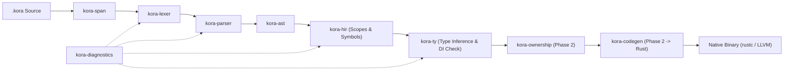

# Kora System Architecture & Engineering Blueprint

## 1. Identity & Core Vision

**Kora** (*Write Less. Build Faster. Run Smarter.*) is a compiled, statically typed backend programming language and integrated web/data ecosystem powered by Rust.

Rather than acting as a thin macro library inside Rust, Kora is a full compiler and toolchain pipeline:
1. **Kora Language**: Clean, semicolon-optional syntax inspired by TypeScript, Kotlin, and Swift.
2. **Kora Compiler**: Full frontend (`Lexer -> Parser -> AST -> HIR -> Type Checker -> Ownership Analyzer`) lowering validated HIR into idiomatic Rust compiled via `rustc`/LLVM into a native binary.
3. **Kora Runtime**: Structured async concurrency built atop `Tokio`, distinguishing cooperative `async` I/O concurrency from multi-core CPU parallelism.
4. **Kora Framework**: Zero-config HTTP engine (`Axum` over `Hyper`), built-in compile-time Dependency Injection, validation, and automatic OpenAPI generation.
5. **Kora Data Engine**: Low-overhead, compile-time checked ORM and query builder atop `SQLx` (PostgreSQL first).
6. **Kora Developer Ecosystem**: `kora` CLI, `kora.toml` / `kora.lock` package manager, LSP server, testing/benchmark suite, and AI-agent governance (`.agent/`).

---

## 2. Compiler Pipeline Architecture

All compiler crates live under `crates/` with strict unidirectional dependencies:

### Why Validated Rust Codegen for v0.1?
- **Zero Borrow-Checker Leakage**: Semantic, type, interface conformance, and ownership checks execute inside Kora's own frontend (`kora-hir`, `kora-ty`, `kora-ownership`). Every error points to `.kora` source spans via `kora-diagnostics`.
- **Full LLVM Optimization & Ecosystem Access**: Emitting verified Rust unlocks LLVM optimizations, static linking, cross-platform targets (`x86_64`/`aarch64` Linux, macOS, Windows), and Battle-tested crates (`tokio`, `axum`, `sqlx`, `serde`) immediately.

---

## 3. Crucial Engineering Principles (Corrected Design Promises)

### 3.1 Zero-GC with 3-Tier Ownership Inference
Hiding lifetime annotations (`'a`) in surface syntax does **not** mean ignoring ownership internally. Kora resolves memory management deterministically across three tiers:
1. **Tier 1 — Local Scope Borrow Inference**: Function parameters read without mutation lower to shared borrows (`&T`). Parameters mutated in-place lower to `&mut T`. Values returned or stored transfer ownership (`Move`).
2. **Tier 2 — Async, Handler & DI Escape Promotion**: Service `class` instances and state captured across HTTP handlers or `async` tasks automatically lower to `Arc<T>` (immutable shared services) or message-passing channels.
3. **Tier 3 — Explicit Escape Fallback & Diagnostics**: When cyclic or ambiguous mutable aliasing cannot be proven safe statically, `kora-ownership` emits a Kora-native diagnostic suggesting value cloning or channel message passing—never delegating raw `rustc` lifetime errors to the user.

### 3.2 Hybrid Object & Data Model (No Fragile State Inheritance)
Deep class field inheritance (`Admin extends User`) clashes with flat memory layout and trait dispatch in Rust. Kora separates concerns cleanly:
- `struct`: Lightweight value types (`Point`, `Money`, DTOs).
- `model`: Persistent domain entities mapped to database tables (`model User { ... }`), automatically deriving serialization and query schemas.
- `interface`: Behavioral contracts (`interface PaymentGateway { ... }`) lowered to Rust `trait`s.
- `class`: Service components (`class UserService implements UserRepository`) featuring `init(...)` constructors wired automatically via **Compile-Time Dependency Injection**.

### 3.3 Explicit Async Concurrency vs Parallelism
- I/O-bound operations (`HTTP`, `Database`, `Queues`, `WebSockets`) run asynchronously on `Tokio`'s multi-threaded work-stealing scheduler.
- Kora avoids hidden "everything is auto-async" ambiguity: `async fn` and route handlers clearly delineate suspension boundaries while keeping zero-config ergonomics at the top level.

### 3.4 Low-Overhead ORM & Contextual Security
- **ORM**: Eliminates runtime reflection and dynamic query AST allocation where queries are statically known, while preserving realistic connection pooling, transaction boundaries, and parameterized SQL (`SQLx`).
- **Security**: Context-specific protection—parameterized SQL bindings, typed JWT/Session extractors, RBAC attributes, CORS/CSRF policies per route group, and structured input validation.

---

## 4. Benchmark Methodology (Phase 8 Standard)

Kora performance claims must be backed by reproducible benchmarks against:
- **Rust + Axum** (Theoretical ceiling baseline)
- **Go + Gin**
- **Node.js + Fastify**
- **PHP + Laravel (Octane / FPM)**

Measured across identical hardware and container limits on isolated workloads (JSON routing, validation, DB single-row read, DB transaction write):
- Throughput (`Requests/sec`), Tail Latency (`P50`, `P95`, `P99`), RSS Memory, CPU utilization, Cold Startup Time, and Stripped Native Binary Size.

